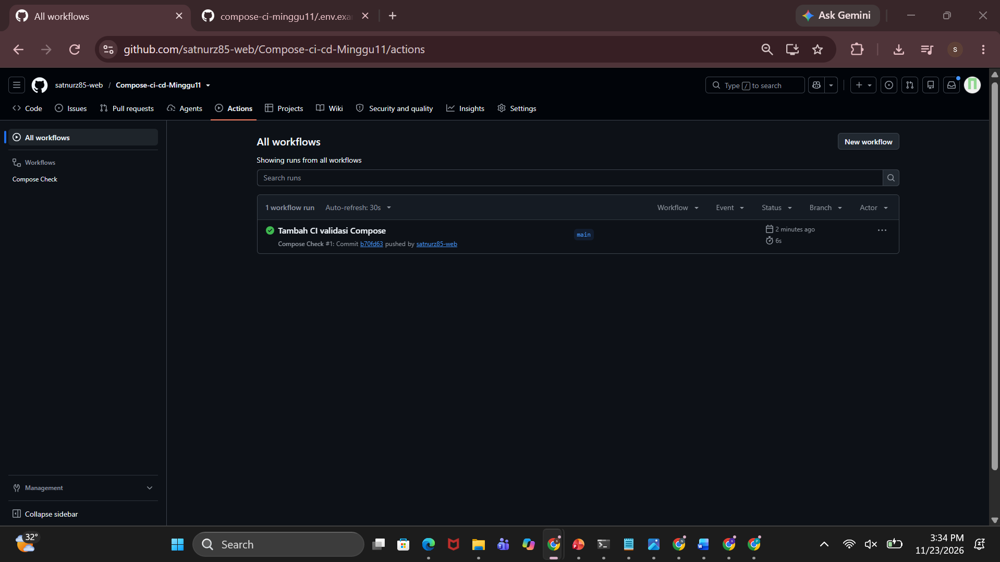
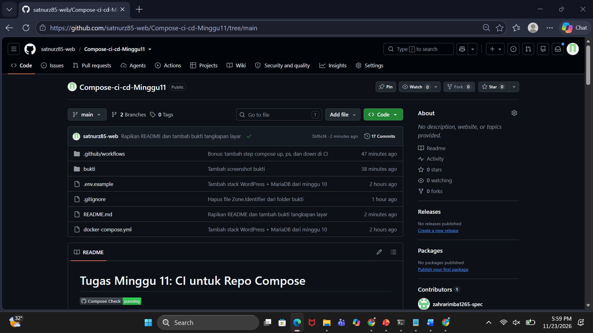
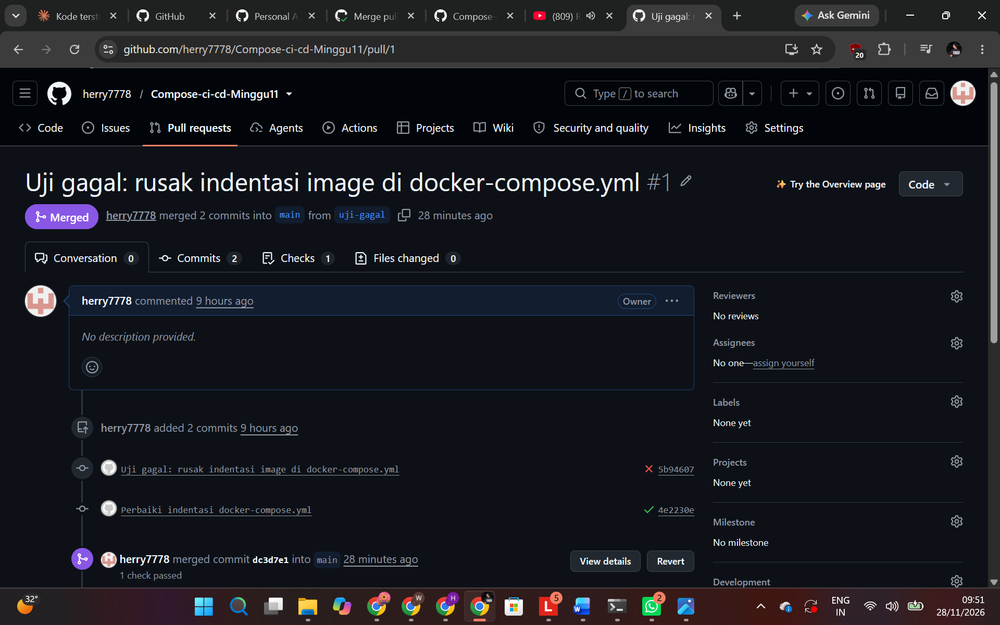

# Tugas Minggu 11: CI untuk Repo Compose

**Nama:** Nadya Shafwah Mujahidin

**NIM:** 202557201048

**Mata kuliah:** Teknologi Open Source

## Deskripsi
Workflow ini memvalidasi sintaks file docker-compose.yml (stack WordPress + MariaDB) secara otomatis. Workflow berjalan setiap ada push ke branch main dan setiap ada Pull Request.

## Isi repositori
- .github/workflows/compose-check.yml : workflow CI
- docker-compose.yml : stack WordPress + MariaDB (tugas minggu 10)
- .env.example : contoh variabel lingkungan tanpa rahasia asli
- .gitignore : mengabaikan .env
- bukti/ : tangkapan layar bukti pengerjaan

## Cara kerja workflow
Pemicunya adalah event push ke branch main dan pull_request. Workflow punya satu job bernama validate yang berjalan di runner ubuntu-latest. Job ini punya tiga step: 
(1) checkout untuk mengambil kode repo ke runner
(2) menyalin .env.example menjadi .env karena file .env asli tidak ada di repo
(3) menjalankan docker compose config -q untuk memeriksa sintaks file Compose tanpa menjalankan container.
(4) docker compose up -d untuk menjalankan stack
(5) docker compose ps untuk menampilkan status container
(6) docker compose down -v untuk mematikan stack. 
Step 4 sampai 6 adalah step bonus.

## Bukti
1. Run hijau di tab Actions

   

2. Pull Request dengan check gagal (merah)

   

3. Badge status di README

   

4. Pull Request sudah di-merge

   

5. Riwayat run di tab Actions (merah lalu hijau)

   

Tautan Pull Request (sudah hijau dan di-merge): https://github.com/satnurz85-web/Compose-ci-cd-Minggu11/pull/1

## Kendala dan cara mengatasinya
**Kendala 1: peringatan variable is not set.** Saat menjalankan docker compose config -q muncul pesan: WARN[0000] The "MYSQL_ROOT_PASSWORD" variable is not set. Defaulting to a blank string. Penyebabnya, .env.example memakai nama variabel DB_NAME, DB_USER, DB_PASSWORD, dan DB_ROOT_PASSWORD, sedangkan docker-compose.yml memanggil MYSQL_DATABASE, MYSQL_USER, MYSQL_PASSWORD, dan MYSQL_ROOT_PASSWORD. Saya memperbaikinya dengan menulis ulang .env.example memakai nama MYSQL_..., menyalinnya lagi menjadi .env, lalu warning hilang.

**Kendala 2: konflik pada README.** README saya diedit lewat web GitHub dan juga lewat terminal, sehingga git menyisakan penanda konflik di dalam file. Saya memperbaikinya dengan menghapus baris penanda dan menyisakan satu badge, lalu commit ulang.

**Kendala 3: check Pull Request berwarna merah.** TEMPEL_PESAN_ERROR_ASLI_DARI_LOG. Penyebabnya adalah indentasi baris image: kurang satu spasi sehingga YAML tidak valid. Saya mengembalikan indentasi, commit, lalu push ke branch yang sama sampai check menjadi hijau.

## Refleksi singkat
CI membuat kesalahan pada file Compose ketahuan beberapa menit setelah push, sebelum digabung ke main. Dengan begitu saya tidak perlu mengandalkan ingatan untuk memeriksa file secara manual. Hasil hijau atau merah juga terlihat jelas di PR, sehingga perubahan yang rusak tidak ikut ter-merge.

