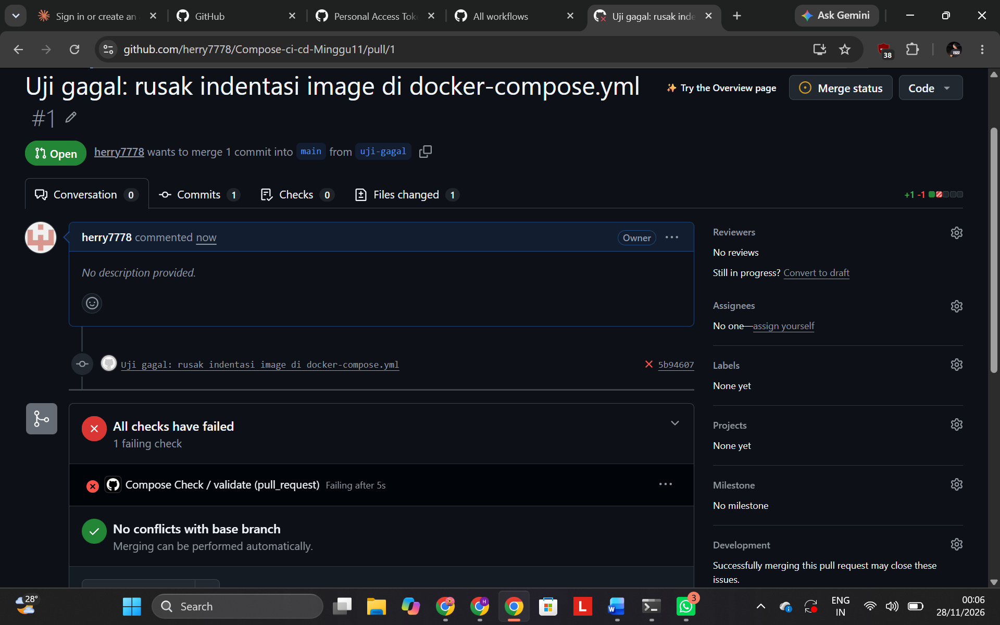
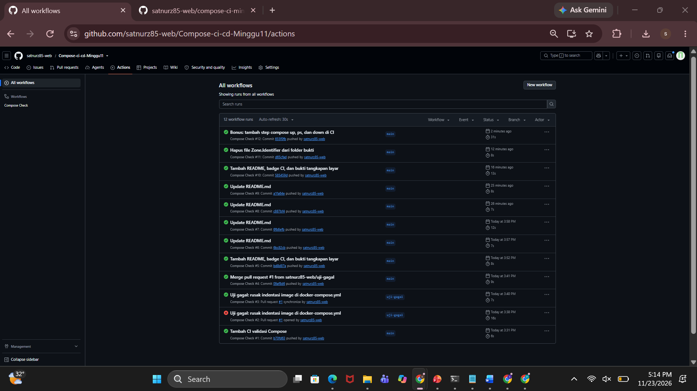
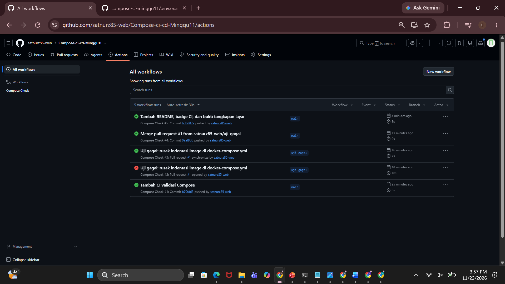

# Tugas Minggu 11: CI untuk Repo Compose

**Nama:** Hery Kurniawan

**NIM:** 202557201043

**Mata kuliah:** Teknologi Open Source

## Deskripsi
Workflow ini memvalidasi sintaks file docker-compose.yml (stack WordPress + MariaDB) secara otomatis, lalu menjalankan stack-nya sebentar untuk memastikan container bisa hidup. Workflow berjalan setiap ada push ke branch main dan setiap ada Pull Request.

## Isi repositori
- .github/workflows/compose-check.yml : workflow CI
- docker-compose.yml : stack WordPress + MariaDB (tugas minggu 10)
- .env.example : contoh variabel lingkungan tanpa rahasia asli
- .gitignore : mengabaikan .env
- bukti/ : tangkapan layar bukti pengerjaan

## Cara kerja workflow
Pemicunya adalah event push ke branch main dan pull_request. Workflow punya satu job bernama validate yang berjalan di runner ubuntu-latest. Job ini punya enam step: 
(1) checkout untuk mengambil kode repo ke runner
(2) menyalin .env.example menjadi .env karena file .env asli tidak ada di repo
(3) menjalankan docker compose config -q untuk memeriksa sintaks file Compose tanpa menjalankan container.
(4) docker compose up -d untuk menjalankan stack
(5) docker compose ps untuk menampilkan status container
(6) docker compose down -v untuk mematikan stack. 
Step 4 sampai 6 adalah step bonus.

## Bukti
1. Run hijau di tab Actions

   

2. Pull Request dengan check gagal (merah)

   

3. Badge status di README

   

4. Run bonus (up, ps, down) hijau

   
5. Pull Request sudah di-merge

   

6. Riwayat run di tab Actions (merah lalu hijau)

   

Tautan Pull Request (sudah hijau dan di-merge): https://github.com/herry7778/Compose-ci-cd-Minggu11/pull/1

## Kendala dan cara mengatasinya
**Kendala 1: check Pull Request berwarna merah.** Pada PR uji-gagal, check Compose Check / validate berstatus Failing karena indentasi baris image: pada docker-compose.yml sengaja dikurangi satu spasi sehingga YAML tidak valid. Saya mengembalikan indentasi, commit, lalu push ke branch yang sama sampai check menjadi hijau, kemudian PR di-merge.

**Kendala 2: git pull gagal karena divergent branches.** Saat git pull muncul pesan "Need to specify how to reconcile divergent branches" karena ada commit lokal yang belum di-push, sedangkan di GitHub sudah ada commit hasil merge PR. Saya mengatasinya dengan git pull --rebase, lalu push ke main.

**Kendala 3: run pertama workflow gagal di branch main.** Setelah file compose-check.yml pertama kali di-push, run "Tambah CI validasi Compose" berstatus Failing (merah) di tab Actions. Saya membuka log run tersebut untuk melihat step yang gagal, memperbaiki file workflow, lalu push ulang dengan commit "Perbaiki workflow compose-check". Run berikutnya berstatus hijau, sehingga workflow bisa dipakai untuk memvalidasi docker-compose.yml.
## Refleksi singkat
CI membuat kesalahan pada file Compose langsung ketahuan setelah push, sebelum digabung ke main, sehingga saya tidak perlu memeriksa file secara manual. Dari PR yang merah lalu hijau, saya belajar bahwa satu spasi indentasi saja bisa membuat YAML tidak valid, dan hasil check yang jelas di PR mencegah perubahan yang rusak ikut ter-merge.
